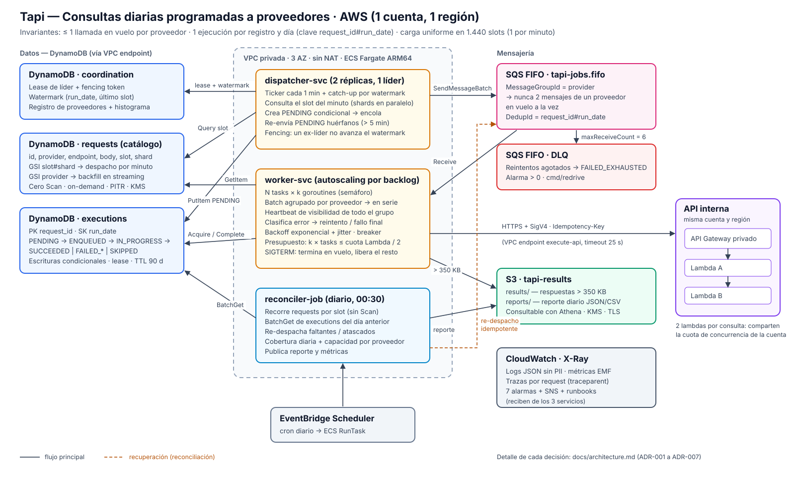

# Tapi — Desafío técnico backend: consultas programadas a proveedores

Sistema que ejecuta **una consulta diaria por cada registro** de una tabla de N registros (1M → N×), **distribuida a lo largo del día**, **sin concurrencia por proveedor**, con **manejo de errores reintentables y no reintentables** y **persistencia de resultados**. Todo en AWS.

**Stack**: Go · DynamoDB · SQS FIFO · ECS Fargate (ARM64) · EventBridge Scheduler · S3 · CloudWatch/X-Ray · Terraform · Docker/LocalStack · GitHub Actions.
**Metodología**: SDD (spec → plan → tasks) + TDD estricto + Clean Architecture.

## Contexto de negocio (supuesto)

Se asume que cada registro representa la **adhesión de un usuario a un servicio** (donde el `provider` es una empresa de servicios o agregador) y que la consulta diaria verifica **deuda o facturas pendientes**. Bajo este modelo, la regla de **no concurrencia por proveedor** protege a proveedores con sistemas legados frágiles o *rate limits* estrictos, y los `body` / respuestas pueden contener datos personales (por lo que nunca se loguean sin enmascarar).

> Este contexto de dominio es un **supuesto** adoptado para tomar decisiones de diseño concretas; la validación con el negocio queda como pregunta abierta para Tapi (ver [docs/architecture.md §7](docs/architecture.md#7-supuestos-y-preguntas-abiertas-para-tapi)).

## Guía para el evaluador

| Criterio del enunciado | Dónde verlo |
|---|---|
| **Diagrama de arquitectura** | Imagen abajo ([docs/architecture-diagram.png](docs/architecture-diagram.png)) + versión editable ([docs/architecture-diagram.svg](docs/architecture-diagram.svg)) + [docs/architecture.md §2](docs/architecture.md#2-diagrama) (diagramas Mermaid de componentes y secuencia) |
| **Justificación de decisiones** | [docs/architecture.md §5](docs/architecture.md#5-decisiones-de-arquitectura-adr) (ADR-001 a ADR-007), [docs/costs.md](docs/costs.md), [docs/failure-modes.md](docs/failure-modes.md) |
| **Ciclo de vida de desarrollo** | [specs/006-infraestructura-y-delivery/plan.md](specs/006-infraestructura-y-delivery/plan.md) (sección SDLC), [specs/constitution.md](specs/constitution.md), [.github/workflows/](.github/workflows/), historial de git (commits `test:` antes de `feat:`) |
| **Plan de desarrollo** | Sección [Plan de desarrollo (hitos)](#plan-de-desarrollo-hitos) en este README + `specs/00X/tasks.md` ([001](specs/001-catalogo-y-slots/tasks.md), [002](specs/002-dispatcher/tasks.md), [003](specs/003-worker-ejecucion/tasks.md), [004](specs/004-errores-y-reintentos/tasks.md), [005](specs/005-observabilidad-y-reconciliacion/tasks.md), [006](specs/006-infraestructura-y-delivery/tasks.md)) |
| **Evidencia** | [docs/evidence/final-report.md](docs/evidence/final-report.md) (matriz de trazabilidad, SCs medidos vs proyectados y checkpoints por feature) |



## Qué está medido y qué no

- **Medido en local (LocalStack + tests con `-race`)**: exclusividad por proveedor (`max_provider_inflight = 1` medido externamente por `mockapi`), idempotencia (`duplicate_idem_keys = 0` con 5 % de duplicados inyectados), cobertura diaria (`100 %` tras reconciliación con *fault injection*), clasificación de errores/reintentos/aislamiento/DLQ/redrive, *graceful shutdown* sin pérdida de mensajes, memoria acotada del backfill (`O(k_max)`), uniformidad de slots en 1M registros (≤ 1,23 % desvío), overhead p99 del worker (`0,657 ms`) y throughput E2E local (`85,2 req/s` uniforme en 200 proveedores; `61,8 req/s` bajo Zipf con `wall/serial = 1,011`).
- **Proyectado (cálculo analítico sobre mediciones de CPU/overhead)**: throughput sostenido en AWS real (`> 300 req/s` con 4 tasks Fargate × 32 inflight frente a 120 req/s objetivo para 10M) y tiempos de ejecución a escala 1M / 100M en DynamoDB/SQS reales (ver [docs/evidence/final-report.md](docs/evidence/final-report.md) y [docs/evidence/load-test.md](docs/evidence/load-test.md)).
- **No ejecutado**: `terraform apply` contra una cuenta de AWS real (la infraestructura está validada con `terraform fmt`, `terraform validate`, `terraform test` con `mock_provider`, `tflint` y `checkov`).

## Documentos
| Documento | Contenido |
|---|---|
| [Constitución](specs/constitution.md) | Principios no negociables del proyecto |
| [Arquitectura](docs/architecture.md) | Trazabilidad al enunciado, diagramas, capacidad, ADRs, alta disponibilidad y DR, supuestos |
| [Diagrama de arquitectura (SVG)](docs/architecture-diagram.svg) | Vista consolidada VPC privada sin NAT + servicios AWS |
| [Costos mensuales (1M / 10M / 100M)](docs/costs.md) | Estimación mensual detallada y palancas de optimización |
| [Análisis de modos de falla (FMEA)](docs/failure-modes.md) | Modos de falla, detección, mitigación y runbooks |
| [Reporte final de trazabilidad](docs/evidence/final-report.md) | Matriz R/C/T → FR → test → evidencia y estado de todos los SC |
| [006 · plan](specs/006-infraestructura-y-delivery/plan.md) | Ciclo de vida de desarrollo (SDLC) |

## Features (SDD)
| # | Feature | Requisitos del enunciado | Prioridad |
|---|---|---|---|
| 001 | [Catálogo y slots](specs/001-catalogo-y-slots/spec.md) | R1, R2, C1 | P1 |
| 002 | [Dispatcher](specs/002-dispatcher/spec.md) | R1, R2, R5 | P1 |
| 003 | [Worker: ejecución, exclusividad e idempotencia](specs/003-worker-ejecucion/spec.md) | R3, R5, C2, C3 | P1 |
| 004 | [Errores y reintentos](specs/004-errores-y-reintentos/spec.md) | R4, C3 | P1 |
| 005 | [Observabilidad y reconciliación](specs/005-observabilidad-y-reconciliacion/spec.md) | R1, R4 | P1 |
| 006 | [Infraestructura y delivery](specs/006-infraestructura-y-delivery/spec.md) | T1, C2, C3, SDLC | P1 |

## Plan de desarrollo (hitos)
| Hito | Contenido | Entregable demostrable |
|---|---|---|
| **M0 — Fundaciones** (día 1) | 006-Fase 1, 001-Setup, constitución, ADRs | `make up` levanta el entorno local |
| **M1 — Distribución temporal** (días 2–3) | 001 completo, 002 US1–US2 | 1 día simulado: cada registro despachado exactamente 1 vez |
| **M2 — Ejecución segura** (días 4–5) | 003 US1–US4 | **Evidencia**: `max_inflight/proveedor = 1`, 0 duplicados |
| **M3 — Resiliencia** (día 6) | 004 completo, 002 US3–US4, 003 US5 | Proveedor caído sin afectar a los demás; failover de líder |
| **M4 — Operabilidad** (día 7) | 005 completo | Cobertura 100 % con fault injection; dashboard |
| **M5 — Producción** (día 8) | 006 Fases 2–5 | Terraform validado (validate, test con mocks, tflint, checkov) + CI/CD + costos + FMEA; apply fuera de alcance del challenge |

Camino crítico: 001-US1 → 002-US1 → 003-US1/US2 → 004 → 005.

## Quick start

**Prerequisitos**: Docker, Go 1.26, `make`.

```bash
make up      # LocalStack + mockapi + servicios
make demo    # tarda ~1-2 min: siembra registros, simula 1 día completo y muestra cobertura y concurrencia por proveedor
make test    # unit + race
make it      # integración (LocalStack)
```
