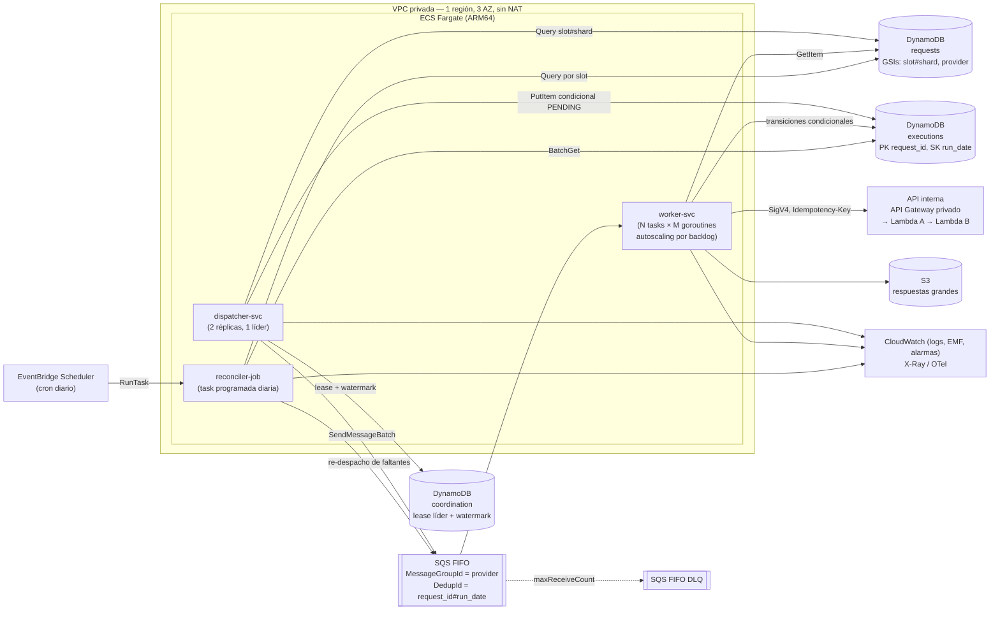
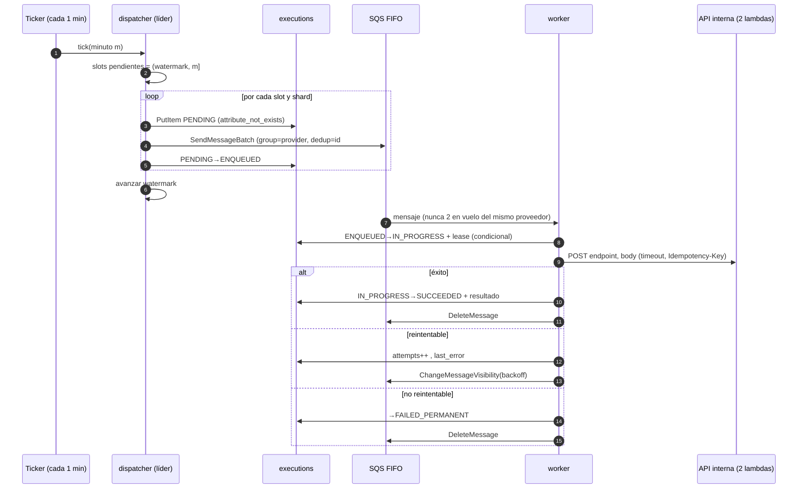
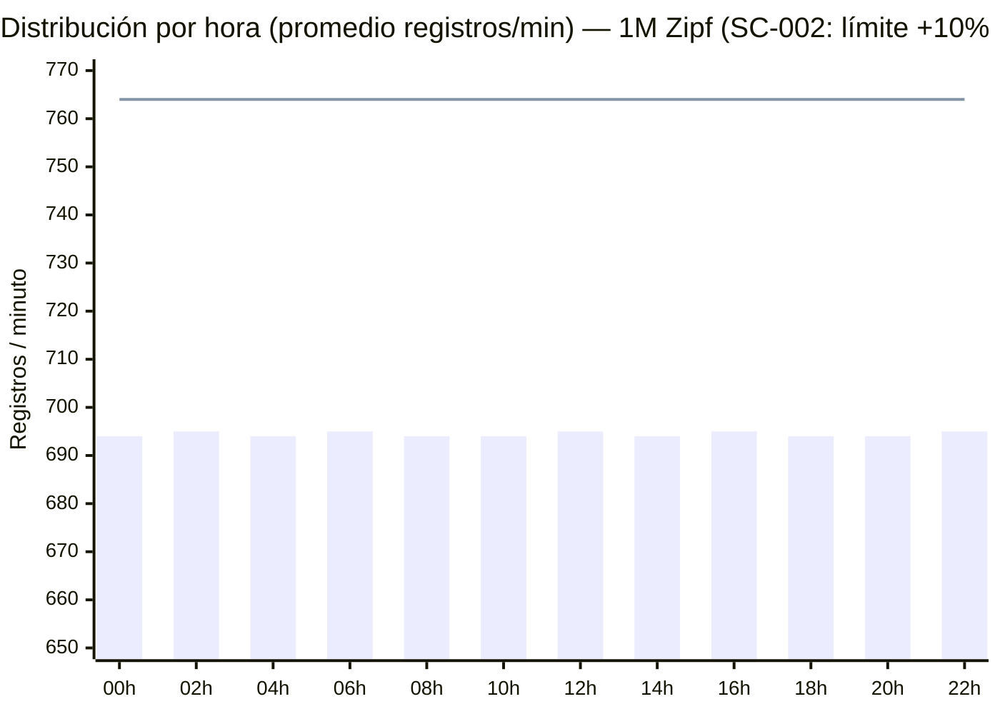

# Arquitectura — Tapi Scheduled Provider Queries

## 1. Problema (resumen del enunciado)

| # | Requisito / consideración del enunciado | Cómo se cumple | Feature |
|---|---|---|---|
| R1 | Consulta **diaria** para **cada** registro, de forma **automática** | Cada registro tiene un `slot` (minuto del día). El dispatcher despacha cada slot una vez por día, con catch-up de minutos perdidos y reconciliación diaria que verifica el 100 % de cobertura | 001, 002, 005 |
| R2 | Consultas **distribuidas a lo largo del día** | Asignación de 1440 slots, uniforme en total y **por proveedor**. Cada minuto se despacha ~N/1440 registros | 001, 002 |
| R3 | **Guardar el resultado** en una base de datos | Tabla `executions` (DynamoDB). Las respuestas de más de 350 KB se guardan en S3 con un puntero | 003 |
| R4 | Errores **reintentables y no reintentables** | Clasificador de errores + backoff exponencial con jitter + `ChangeMessageVisibility` + DLQ + circuit breaker por proveedor | 004 |
| R5 | **Evitar concurrencia a un mismo proveedor** | SQS FIFO con `MessageGroupId = provider` (garantía de la infraestructura) + lease de ejecución en DynamoDB (defensa en profundidad) | 003 |
| C1 | **1M de filas, escalando N veces** | Cero `Scan` (ni en runtime ni en backfill): GSI `gsi_slot_shard` (shards configurables) + GSI `gsi_provider` (backfill en streaming `O(k_max)`), workers con autoscaling. Capacidad calculada en la sección 4 | 001, 002, 006 |
| C2 | **Misma región y misma cuenta de AWS** | Acceso privado por VPC endpoints, IAM sin cross-account, **cuotas compartidas** (ver C3). Una sola región: alta disponibilidad multi-AZ y DR con PITR (sección 6) | 006 |
| C3 | La API interna **ejecuta dos lambdas** | Cada consulta consume ~2 unidades de la **concurrencia de Lambda de la cuenta**, compartida con todo lo demás. Los workers corren en ECS (no compiten) y tienen un **presupuesto global de llamadas en vuelo** derivado de esa cuota. Timeouts que contemplan cold starts y la cadena de dos lambdas | 003, 004, 006 |
| T1 | **Todo el stack de AWS** | ECS Fargate, SQS FIFO, DynamoDB, EventBridge Scheduler, S3, CloudWatch, X-Ray, KMS, ECR, Terraform | 006 |

## 2. Diagrama



### Flujo de una ejecución



## 3. Máquina de estados de una ejecución (`request_id#run_date`)

```
PENDING ──► ENQUEUED ──► IN_PROGRESS ──► SUCCEEDED
                ▲              │
                │              ├──► RETRYING ──► IN_PROGRESS (vuelve a entrar)
                │              ├──► FAILED_PERMANENT        (no reintentable)
                └── reconciler └──► FAILED_EXHAUSTED        (DLQ, reintentos agotados)
```
Toda transición es un `UpdateItem` con `ConditionExpression` sobre el estado previo, lo que garantiza idempotencia y evita carreras.

## 4. Capacidad (cálculo)

Supuestos: latencia p95 de la API (dos lambdas en cadena) `L = 400 ms`; factor de seguridad 0,7.

| Registros | Req/s promedio | Por slot (min) | Llamadas en vuelo ≈ rate × L | Concurrencia Lambda de la API ≈ 2 × rate × L |
|---|---|---|---|---|
| 1M | 11,6 | 694 | ~5 | ~10 |
| 10M | 116 | 6.944 | ~47 | ~93 |
| 100M | 1.157 | 69.444 | ~463 | **~926 → requiere aumento de cuota** (default 1.000 por región, compartida) |

- **Límite por proveedor** (consecuencia directa de R5): un proveedor procesa en serie, así que su volumen diario máximo es `86.400 s × 0,7 / L ≈ 151.000` registros con L = 400 ms. La feature 001 **valida y alerta** si un proveedor supera ese umbral. Es un límite del negocio, no de la arquitectura, y se documenta como pregunta abierta para Tapi.
- **Presupuesto de llamadas en vuelo**: `max_tasks × inflight_per_task ≤ (cuota_lambda × 0,5) / 2`, configurado en Terraform y verificado en el arranque del worker.
- **GSI `slot#shard`**: con S shards, cada partición de GSI tiene N/(1440·S) ítems. Se usa S = 4 para 1M y S = 32 para 100M, con queries en paralelo por shard.

## 5. Decisiones de arquitectura (ADR)

### ADR-001 — DynamoDB en lugar de PostgreSQL (Aurora)
**Contexto**: los patrones de acceso son clave-valor: registros por slot y ejecución por `id+fecha`. Hay ~1M de escrituras de resultados por día (365M por año), con crecimiento N×.
**Decisión**: DynamoDB on-demand, con PITR, TTL y cifrado KMS.
**Alternativa considerada**: Aurora PostgreSQL, con una cola sobre `SELECT … FOR UPDATE SKIP LOCKED` y advisory locks por proveedor. Es válida y mejor para reporting ad-hoc.
**Por qué no**: exige particionar la tabla de resultados por fecha, VACUUM y bloat; escala vertical; dimensionar, mantener y hacer failover de la instancia; tiene costo fijo 24/7. DynamoDB escala horizontalmente sin cambios y el TTL resuelve la retención.
**Consecuencias**: el reporting se hace con DynamoDB Export to S3 + Athena. Si la tabla de origen del enunciado es relacional, se migra una vez con *Import from S3* (o DMS) y se sincroniza con CDC (ver supuestos).

### ADR-002 — ECS Fargate en lugar de Lambda para los workers
**Contexto**: la carga es constante las 24 horas. La API interna corre en **2 lambdas en la misma cuenta y región** y comparte la cuota de concurrencia.
**Decisión**: `dispatcher-svc` y `worker-svc` como servicios ECS Fargate en ARM64; `reconciler` como task programada.
**Por qué**: los workers en Lambda competirían por la misma cuota que la API (riesgo de auto-throttling). ECS da control fino de la concurrencia (goroutines, pool HTTP keep-alive, rate limiting en memoria) y cuesta menos con carga sostenida. El dispatcher es un servicio siempre corriendo porque el arranque de un task de Fargate (30–60 s) es incompatible con un `RunTask` por minuto.
**Consecuencias**: hay que gestionar autoscaling, graceful shutdown y elección de líder.

### ADR-003 — SQS FIFO con `MessageGroupId = provider` para la exclusividad
**Decisión**: SQS FIFO en *high-throughput mode*. La exclusividad la garantiza la infraestructura: SQS no entrega un mensaje de un grupo mientras otro del mismo grupo está en vuelo, para cualquier cantidad de consumidores.
**Alternativas**: locks distribuidos en DynamoDB (más código y más modos de falla) o Step Functions por proveedor (costo y complejidad).
**Defensa en profundidad**: un lease en `executions` evita la doble ejecución si vence el visibility timeout.
**Consecuencia aceptada**: hay *head-of-line blocking* por proveedor. Si un proveedor falla, se frenan sólo sus mensajes (backpressure deseado) y no los de los demás.

### ADR-004 — Distribución temporal por slots precalculados
**Decisión**: `slot = f(provider, id) ∈ [0, 1440)`, asignado con reparto uniforme por proveedor:
```text
offset(provider) = fnv64a(provider) mod 1440
slot             = (offset + ⌊rank × 1440 / k⌋) mod 1440
shard            = fnv32a(id) mod S
```
Dos GSIs en `requests`: `gsi_slot_shard` (`PK slot_shard`, `SK provider_id`, `INCLUDE`) para despacho y reconciliación; y `gsi_provider` (`PK provider`, `SK id`, `INCLUDE (version, slot, shard, enabled)`) para backfill en streaming ordenado por `SK` sin `Scan`, sin sort en memoria (`O(k_max)` en RAM, independiente de `N`) y sin `GetItem` adicionales para `SetSlot` condicional ni chequeo de seguridad del día en curso (FR-005b). El registro de proveedores (`k` e histograma) vive en `coordination` (usado por backfill, altas incrementales con umbral `> 1440` y validación de capacidad). Un ticker de un minuto con *watermark* y catch-up.

**Evidencia empírica del histograma con 1M de registros (50 proveedores, S=4 shards)**:
- **Uniforme (50 × 20k)**: promedio `694,44/min`, min `692`, max `696`, desvío máx. **0,352 %** (SC-002 ≤ 10 %), exceso por proveedor sobre `⌈k/1440⌉` = `0`, shards `[250001, 249999, 249999, 250001]`.
- **Zipf sesgado (50 proveedores)**: promedio `694,44/min`, min `686`, max `703`, desvío máx. **1,232 %** (SC-002 ≤ 10 %), exceso por proveedor sobre `⌈k/1440⌉` = `0`, shards `[250004, 249995, 249999, 250002]`.



**Alternativas**: un schedule de EventBridge por registro (1M schedules, cuotas y costo, no resuelve la exclusividad), un `Scan` diario particionado (pico de carga, no reparte en el día), o agrupar/ordenar en memoria durante el backfill (~16 GB con 100M registros, viola escalabilidad `O(1)` en memoria respecto de `N`).

### ADR-005 — Idempotencia en 4 capas con la clave `request_id#run_date`
1) `MessageDeduplicationId` de SQS; 2) `PutItem` condicional de PENDING en el dispatcher (patrón outbox-like); 3) transiciones condicionales y lease en el worker; 4) header `Idempotency-Key` hacia la API.
**Riesgo residual documentado**: si el worker cae después de que la API respondió y antes de persistir, la llamada se repite. Sólo la capa 4 lo evita, y depende de que la API interna respete la clave (pregunta abierta para Tapi).

### ADR-006 — Reintentos: en proceso + visibility timeout + DLQ
Reintentos cortos en proceso (máximo 2, solo errores transitorios rápidos < 1 s, delay 200 ms–1 s con jitter). Después, `ChangeMessageVisibility` con backoff exponencial acotado en `[30 s, 15 min]` y jitter ±20 % (respetando `Retry-After` hasta 15 min). Con `maxReceiveCount = 6`, el mensaje pasa a la DLQ FIFO y la ejecución queda en `FAILED_EXHAUSTED` antes de la derivación. Circuit breaker local por proveedor (ventana deslizante de 20, umbral ≥ 50 %, cooldown 60 s).
- **Aislamiento intra-batch por grupo FIFO**: `Handler.Execute` devuelve `(HandleOutcome, error)` (`OutcomeDone | OutcomeDeferred`). Si un mensaje de un batch del mismo `MessageGroupId` resulta diferido (`RetryLater`, `FailExhausted`, breaker abierto, `LeasedByOther` o error de persistencia), `sqsq.Consumer.processGroup` **corta el procesamiento del resto del batch de ese grupo** y libera los mensajes pendientes con `ChangeMessageVisibility(0)` para no seguir pegándole al proveedor degradado.
- **Heartbeat a nivel de grupo (`ChangeMessageVisibilityBatch`)**: mientras un grupo secuencial procesa su mensaje activo, un único ticker cada `VT/2` extiende la visibilidad de **todos** los mensajes restantes del batch (el activo y los que esperan turno), evitando que un mensaje en cola venza su visibility timeout y se re-entregue antes de ser ejecutado.
**Evidencia E2E (`004-errores-y-reintentos`)**: validado contra LocalStack FIFO (`TestWorker_LocalStack_RetriesExhaustionIsolationAndRedrive`): un proveedor con 100 % 503 agota las 6 entregas, queda `FAILED_EXHAUSTED` y entra a la DLQ mientras los proveedores sanos completan el 100 % sin degradación (SC-002); un HTTP 400 termina `FAILED_PERMANENT` con 0 reintentos (SC-004); `cmd/redrive` re-encola desde la DLQ preservando `MessageGroupId`, `MessageDeduplicationId` y `attempts`.

### ADR-007 — Go + Clean Architecture + Terraform
Go por su concurrencia nativa, binarios estáticos chicos (imágenes *distroless* de ~15 MB), bajo consumo de memoria y el AWS SDK v2. Terraform como IaC por ser estándar de la industria y multi-entorno.

## 6. Alta disponibilidad y recuperación ante desastres (una región, por C2)
- ECS en 3 AZ; DynamoDB y SQS son multi-AZ por diseño.
- DynamoDB PITR (35 días); backups diarios con AWS Backup.
- **RPO** ≤ 5 min (PITR); **RTO** ≤ 1 h (re-deploy con Terraform + restore). Las ejecuciones del día se recuperan con el catch-up y el reconciler.
- Multi-región está fuera de alcance por la consideración C2. Se documenta como evolución posible (DynamoDB Global Tables).

## 7. Supuestos y preguntas abiertas para Tapi
| ID | Supuesto | Si no se cumple |
|---|---|---|
| S1 | El catálogo de registros puede vivir o replicarse en DynamoDB | Migrar con DMS + CDC; el resto del diseño no cambia |
| S2 | La API interna se expone por API Gateway privado con IAM (SigV4) | Adaptador HTTP con otra autenticación, detrás del mismo puerto |
| S3 | La API interna respeta `Idempotency-Key` | Riesgo residual de ADR-005, monitoreado |
| S4 | "Día" se define en UTC (configurable a `America/Argentina/Buenos_Aires`) | Parámetro `RUN_DAY_TZ` |
| S5 | Ningún proveedor supera ~150k registros por día con L p95 = 400 ms | Negociar el límite o relajar la exclusividad (decisión de negocio) |
| S6 | El resultado se considera "consulta realizada" tanto en éxito como en fallo permanente | Se configura la política |
